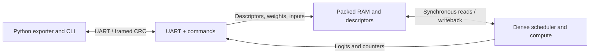

# Configurable FPGA Neural Inference Accelerator

**SystemVerilog INT8 dense inference IP for Arty A7.** A fixed FPGA image accepts different compatible model shapes and parameters over USB–UART. The FPGA performs every dense layer, bias, activation and requantisation step and returns full INT32 logits.

**Release status:** RTL simulation and 7-series structural synthesis checked. Vivado place-and-route, bitstream generation and physical board validation are pending.

## Architecture



- **Runtime model format:** 1–4 dense layers, widths 1–256, 16 KiB packed weight budget and 4 KiB bias budget. Hidden layers use ReLU and fixed-point requantisation. A layer must fit its dimensions and the shared model budget.
- **Compute:** 1, 4 or 8 build-time INT8 multiplier lanes, registered reduction, INT32 accumulation, packed-word prefetch and ping-pong activation memory. All builds consume the same binary model format.
- **Verification:** independent scalar oracle, exhaustive signed INT8 operand-pair tests, protocol negative cases and byte- and pin-level RTL regression. The optional trained fixture uses the regular runtime model loader.
- **Board:** Arty A7-35T/100T Vivado projectless build, 100 MHz target, USB–UART host link and physical acceptance script.

## Reproduce

```bash
python -m verification.regression            # Icarus Verilog and Python 3
python -m verification.regression --trained  # also needs scikit-learn
python -m verification.synth_xc7              # optional Yosys structural mapping
```

For the Arty A7-35T, build the first four-lane variant and then program the generated `npu.bit` from Vivado Hardware Manager.

```powershell
vivado -mode batch -source hardware/vivado/build_a7.tcl -tclargs 35 4
python -m pip install pyserial
python -m verification.board_test COM4 --lanes 4 --bitstream hardware/build/arty_a7_35t_p4/npu.bit --out local_results/a7_p4.json
```

Replace `COM4` with your board's UART port. The acceptance script compares every returned logit for A→B→A and 100 further inputs while the same bitstream is programmed. It records core cycles, model load time and host round-trip time separately.

## Engineering documentation

- [Verification results and 1/4/8-lane comparison](docs/V1_VERIFICATION_RESULTS.md)
- [Arty A7 build, programming and physical acceptance](docs/V1_BOARD_TEST.md)
- [Implemented RTL hierarchy and command response layouts](docs/V1_IMPLEMENTATION.md)
- [V1 binary model format, frame protocol and integer arithmetic](docs/V1_PROTOCOL_AND_MODEL_IMAGE.md)
- [Architecture specification and design decisions](docs/RTL_SYSTEM_DESIGN_V1.md) · [RTL contracts](docs/RTL_MODULE_CONTRACTS_V1.md)
- [Benchmark acceptance gates](docs/FLAGSHIP_ACCEPTANCE_AND_BENCHMARK_PLAN.md) · [Roadmap](docs/ROADMAP.md) · [Reference designs](docs/COMPETITOR_REVIEW_AND_DIFFERENTIATION.md)
