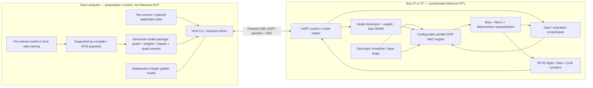

# Configurable FPGA Neural Inference Accelerator

**An application-agnostic, resource-conscious INT8 inference-engine architecture for Xilinx 7-series FPGAs.**

> **Status: Architecture specification / planning baseline (25 November 2026).** No RTL implementation, simulation PASS, synthesis, bitstream, hardware measurement, or model-compatibility claims are made by this new repository until evidence is attached.

## Why this project exists

The deliverable is the **neural accelerator IP itself**, not a motor monitor, camera pipeline, or digit-recognition GUI. A stable FPGA bitstream will accept *different compatible pre-trained neural networks* and execute them using the same inference RTL. Model architecture/size can change **within a documented supported operator set and on-chip memory limits** without recompiling HDL. A host computer prepares and loads model descriptors, weights and inputs; multiply-accumulate, bias, activation, quantisation and inference scheduling run on the FPGA.

**This is a compact NPU-style FPGA research prototype, not a general-purpose CPU, universal ONNX runtime, commercial NPU, or large-language-model accelerator.**

## System context

## What makes the architecture reusable?

- **Compute hardware is independent of application and model name.** No hard-coded sensor features, image sizes, labels, motor model, or named dataset in RTL.
- **Runtime model loading is a mandatory V1 acceptance criterion.** At least two differently shaped supported neural networks must run with the **same bitstream**, with bit-exact agreement against an independent software oracle.
- **Model limits are explicit.** Initial proposed support: feed-forward dense (fully connected) layers, ReLU, signed INT8 inputs/weights, INT32 accumulators/biases, deterministic integer requantisation; maximum layers/dimensions/weight storage set by build parameters and reported by GET_CAPS. Convolution, attention, pooling, softmax and arbitrary ONNX operators are **not** claimed in V1.
- **Parallelism is configurable at build time** (1, 4, 8 lanes proposed), with evidence-based area–speed–power trade-off analysis.
- **Board-specific code is isolated.** Portable RTL core and portable model-package format; A7-first implementation, then S7 port after board/clock/XDC verification.

## Planned evidence-based development stages

| Stage | Deliverable | Passing gate |
|---|---|---|
| M0 | Design, model format, arithmetic contract, interface and verification specifications | Reviewed, consistent docs with no unbounded claims |
| M1 | MAC, reduction, activation and requantisation RTL | Bit-exact directed/random unit tests |
| M2 | Descriptor-driven dense-layer engine and memories | Multi-layer synthetic vectors match independent integer oracle |
| M3 | Runtime loader and transport | Two different model shapes load/infer on same RTL configuration |
| M4 | Arty A7 hardware | Physical results and counters match reference; routed timing documented |
| M5 | 1/4/8-lane comparative implementations and Arty S7 port | Same results, measured resource/timing/latency per implemented configuration |
| M6 | Compatible trained-model proof and publishable engineering case study | Document source/provenance, accuracy, bit-exact FPGA outputs and tested configuration |
| M7+ | Additional operators, AXI interfaces, compiler improvements | Each extension has its own verification and acceptance gate |

## Detailed RTL design — architecture before diagrams

The design has now been specified to module and memory-port level. **It is a proposed V1 FPGA microarchitecture, not implemented or physically verified hardware yet.** Final diagrams will be prepared only after the interface hierarchy and RTL correspond.

- [Full RTL system design and physical hierarchy](docs/RTL_SYSTEM_DESIGN_V1.md)
- [Module-level contracts, PE hierarchy and timing](docs/RTL_MODULE_CONTRACTS_V1.md)
- [Exact model-image format, UART protocol and fixed-point math](docs/V1_PROTOCOL_AND_MODEL_IMAGE.md)
- [Architecture decisions, explicit limitations and verification risks](docs/ARCHITECTURE_DECISIONS.md)

V1 is a **1D 1/4/8-lane parallel PE vector**, with banked/packed memory and a runtime-loadable dense network. It is **not** a 2D systolic array; no external AXI/DDR DMA or application-specific feature extraction is included in the FPGA.

## Engineering benchmark and flagship-quality release criteria

Our ambition is stronger **verified custom accelerator IP**—not merely a larger README or more complex application. The following references were reviewed for real design structure and evidence; comparisons are qualitative until workloads and boards are made comparable:

- [Three-repository code/evidence review and competitive differentiation](docs/COMPETITOR_REVIEW_AND_DIFFERENTIATION.md)
- [Flagship FPGA validation, PPA benchmark methodology, and CNN extension gates](docs/FLAGSHIP_ACCEPTANCE_AND_BENCHMARK_PLAN.md)

Core V1 (runtime-programmable dense INT8 inference) remains the first implementation target. A genuine CNN datapath is a later, test-gated extension. No performance advantage over the reference repositories is claimed until physical evidence exists.

## Engineering documentation

- [Project charter and acceptance criteria](docs/PROJECT_CHARTER.md)
- [System architecture, RTL hierarchy, control and dataflow](docs/ARCHITECTURE.md)
- [Model-loading and integer arithmetic contract](docs/MODEL_CONTRACT.md)
- [Verification and performance measurement](docs/VERIFICATION.md)
- [Implementation roadmap, reuse/integration strategy and risks](docs/ROADMAP.md)

## Repository status and publication policy

There is **no application code** in this planning release. The named directories contain future module responsibilities, not pretended working RTL. Implementation will be added behind reviewed milestones; generated Vivado caches, `.runs`, raw datasets, private data and local tool output are excluded from version control. All performance data will be identified as *predicted*, *simulated*, *synthesised*, or *physically measured*, never conflated.

Target portfolio roles: FPGA/RTL Engineer, Neural Accelerator/NPU Architect (prototype), ASIC/SoC Verification, Embedded AI Hardware, Architecture and PPA Exploration.