# Architecture specification — application-independent FPGA NPU-style subsystem

**Status:** conceptual system-context page. For **authoritative V1 RTL module names, memory sizes, dataflow, ports and protocol**, use [RTL_SYSTEM_DESIGN_V1.md](RTL_SYSTEM_DESIGN_V1.md), [RTL_MODULE_CONTRACTS_V1.md](RTL_MODULE_CONTRACTS_V1.md) and [V1_PROTOCOL_AND_MODEL_IMAGE.md](V1_PROTOCOL_AND_MODEL_IMAGE.md). This page is an earlier conceptual overview and may use less precise block names. **V1 is designed but not yet implemented.**

## 1. System boundary: what lives where

```mermaid
flowchart LR
  subgraph PC["HOST CPU / LAPTOP — NON-RTL"]
    M["External or locally trained compatible model"] --> C["Model importer + INT8 compiler/exporter"]
    C --> IMG["Graph descriptors, weight and bias package"]
    H["CLI/test client + sample generator"] --> UART["Host serial transport"]
    IMG --> UART
    REF["Independent integer reference"] --- H
  end
  subgraph FPGA["FPGA FABRIC — IMPLEMENTED IN RTL"]
    RX["UART RX/TX + CRC"] --> CMD["Protocol decoder + command dispatcher"]
    CMD --> LOADER["Validated model loader / commit controller"]
    LOADER --> MEM["Model SRAM and descriptor RAM"]
    CMD --> SCHED["Inference scheduler + nested loop counters"]
    CMD --> A["Input activation SRAM"]
    MEM --> MAC["Parallel INT8 MAC vector engine"]
    A --> MAC
    SCHED --> MAC
    MAC --> P["Reduction + INT32 bias + ReLU + requantise"]
    P --> B["Output/next-layer activation SRAM"]
    B --> A
    P --> R["Result vector + cycle counters"]
    R --> CMD
  end
  UART <-->|"Binary framed commands and results"| RX
```



**Training never occurs on the FPGA in V1.** The FPGA holds only model data, fixed hardware operations and inference control. Model parameters are stored in FPGA block RAM, not magically synthesized from a Python file. Loading a new model **changes data in SRAM, not gates in the FPGA**.

## 2. Subsystem containment and module tree

```text
board_top_a7 / board_top_s7                    board-dependent clock/reset/UART/pins
└── accelerator_soc_top                        portable board-facing integration
    ├── cmd_transport                           frame RX/TX, CRC, sequencer, errors
    ├── capabilities_registers                  supported formats/limits, firmware id
    ├── model_loader                            validates descriptor, bounds, checksum
    │   ├── model_descriptor_ram                 op/dim/offset/quant records
    │   ├── weight_bram_banked                   mutable runtime INT8 weights
    │   └── bias_parameter_bram                  INT32 biases and M/S quant parameters
    └── inference_engine                        portable NPU execution subsystem
        ├── inference_scheduler                 op decode, layer / neuron loops, busy
        ├── activation_sram_pingpong            current/next INT8 vectors
        ├── weight_address_generator            output-major row / lane grouping
        ├── mac_vector #(LANES)                  multiple parallel MAC lanes
        │   └── mac_lane [0:LANES-1]             signed INT8 × INT8, pipelined
        ├── partial_sum_reducer                 deterministic INT32 reduction
        ├── bias_activation_requant             INT32 bias + optional ReLU + M/S
        ├── result_registers                    final vector readout
        └── performance_counters                compute cycles, stalls, faults
```

`MAC` is a multiply-accumulate arithmetic operation; `PE` is a processing element containing arithmetic plus control/registers; the proposed `mac_lane` is a minimal PE. A *linear bank of MAC lanes* is **not** a 2D systolic array. A genuine systolic array, if built later, requires PE-to-PE transport and a specified wavefront/dataflow contract.

## 3. Operational modes and controller states

- `RESET/IDLE`: invalidate previously loaded SRAM model after reconfiguration; wait for host. **RAM bytes need not be zeroed**, but model_valid is cleared.
- `LOAD_HEADER`: read version, op sequence and declared byte counts; validate supported opcodes, bounds, addresses and numeric parameters.
- `LOAD_PAYLOAD`: stage weight, bias, quant and descriptor records; check packet CRC and total-package integrity; reject writes while inference is busy.
- `COMMIT`: atomically set model_valid only after successful validation; an unsuccessful load must never make a partially written model executable. For minimal V1, model reload may clear the previous model rather than preserving it, but this is clearly reported.
- `READY`: accept correctly sized signed INT8 input vector for loaded model.
- `LAYER_SETUP/ISSUE/DRAIN/REDUCE/BIAS/RELU/REQUANT/STORE`: process layer and assemble next input vector.
- `COMPLETE`: hold the final INT32 vector and counters until host acknowledges response.
- `ERROR/RECOVER`: send documented status; no stale outputs can be mistaken for a new job.

## 4. Dataflow: streaming MACs with local SRAM

For dense layer output `j`:

`acc[j] = bias[j] + sum(i=0..input_dim-1) (int32)x[i] * (int32)w[j,i]`

Weight layout: **output-major rows**, contiguous `w[j,0]..w[j,input_dim-1]`. In each issue group, read up to `LANES` adjacent inputs and weights, compute parallel INT8 products, accumulate in deterministic order, apply the bias, run optional fused ReLU/requantise and write the output. Mask tail lanes when the dimension is not divisible by `LANES`; never read past declared weights.

**Memory bandwidth requirement:** The engine must supply `LANES` weight bytes per compute issue, plus the required activation reads. Implement by wide BRAM words and/or banks; exact BRAM mapping must be measured. A multi-lane MAC datapath supplied by one byte-wide RAM will bottleneck and undermine scaling results.

**Pipeline:** explicit valid/ready tags accompany BRAM output, multiplier products, partial sums and result writeback. Drain before reducer/commit. Preserve precision until the specified quantisation stage. One inference job active at a time in V1.

## 5. Model flexibility matrix

| Feature | V1 baseline | Future option |
|---|---|---|
| Different weights/biases | Runtime load, mandatory | Model cache/multi-model switching |
| Different dense layer dimensions | Runtime descriptor, mandatory | Larger dimensions/external DDR |
| Different count of dense layers | Runtime descriptor, mandatory within bounds | Branching/residual graphs |
| Input/output semantic meaning | Opaque numeric vectors | Application adapters in separate repos |
| ReLU, INT8/INT32 | Mandatory | Leaky ReLU/GELU, per-channel quantisation |
| Convolution/pooling | Unsupported | Genuine CNN dataflow engine or lowering |
| INT4/FP8/BF16 | Unsupported | New arithmetic variants |
| Systolic architecture | **Not claimed** for 1D MAC lanes | True 2D PE array with wavefront tests |
| External AXI4 / DMA | Not in initial UART-only physical demo | Independent AXI4-Stream/Lite and DMA milestone |

## 6. Board portability

Arty A7-35 uses a 100-MHz oscillator, while Arty S7 variants require different oscillator and XDC handling; never copy A7 pin/clock assumptions to S7. A board wrapper defines reset synchronisation, UART, LEDs and correct clock configuration. Portable core RTL must not depend on pin names, local Vivado paths or fixed example model shapes. Confirm **exact devices and board revisions** before committing XDC files.

## 7. Error handling and observability

Required status/counters: `GET_CAPS` (device, core version, active config, max sizes/op set), `MODEL_STATUS` (valid, model ID, byte count/checksum), `INFER_STATUS` (busy/done/error), compute-only cycle count, stall cycles, invalid packet count, model rejection cause. Capture readable status in CLI and hardware logs. Do not conflate UART time with compute latency.

## 8. Module contracts (to complete during implementation)

Every RTL block must have documented input and output ports, clock/reset semantics, valid/ready timing, signed widths, legal parameter ranges, backpressure, numerical behaviour and self-checking tests. The model loader and arithmetic engine must be independently testable. Do not treat a Vivado elaboration or synthesis success as a substitute for behavioural verification.
