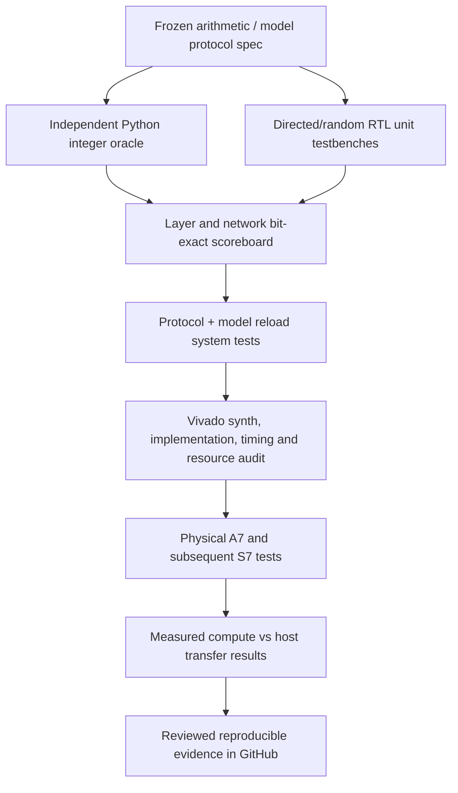

# Verification strategy, PPA methodology and evidence gates

## 1. Verification structure

## 2. Required simulation coverage

| ID | Test | Required evidence |
|---|---|---|
| NUM-01 | Signed INT8 corners: −128, −1, 0, +1, +127; INT32 bias extremes | Exact agreement, no unexpected truncation |
| NUM-02 | Reduction ordering, 1/4/8 lanes, tail mask, partial-product pipeline drain | Exact same output for supported arithmetic ordering |
| NUM-03 | ReLU and rounding (including negative ties), clipping, invalid M/S | Exact independent integer results and explicit errors |
| MEM-01 | Banking, BRAM latency, arbitration, bounds and row-major addressing | No wrong addresses or dropped lanes |
| ENG-01 | One layer, several layers and non-multiple-of-lanes dimensions | All intermediate and final vectors equal reference |
| ENG-02 | At least two different dynamic model shapes in same elaborated core | Reloaded descriptors change behaviour without HDL changes |
| ENG-03 | Reset during model load, computation and result transmission | No stale result or partially valid model |
| PROTO-01 | Packet CRC known vectors, malformed messages, inter-byte timeout, bad sequence | Rejection/recovery and no unintended compute |
| PROTO-02 | Model load partial chunks, wrong offsets and checksum; repeated reloads | Atomic validity, documented error codes |
| SYS-01 | Random vectors plus reproducible fixtures A/B/A | Full bit-exact result vector, model ID and cycle counters |
| PHY-01 | Primary real Arty A7 board, tested model load and inference | Physical captures with source + bitstream hashes |
| PHY-02 | One confirmed Arty S7 board | Separate targeted timing/resources and hardware results |

Use `pytest` for host/reference, Verilator or Icarus for portable RTL, XSim for vendor confirmation, and cocotb/SystemVerilog assertions as appropriate. Record actual tool versions and pass/fail; green test badges only after tests exist and pass.

### Assertions to implement

No memory address outside declared region; model_valid never rises before checks pass; no start when busy; no valid output before all products and stages have drained; valid/ready data remains stable while stalled; descriptor count respected; exactly one response to an accepted request (reset exception); no partial model observed by inference; layer boundary counters/BRAM addressing remain aligned.

### Waveforms and architecture trace

Produce an annotated one-neuron issue trace, complete two-layer trace, reload A/B sequence and reset/error trace. Signals: `model_valid`, `layer_idx`, `neuron_idx`, `input_idx`, `lane_valid`, `w_addr`, `a_addr`, `product`, `lane_psum`, `reduced_sum`, `bias`, `requant`, `result_valid`, `core_cycles`, packet FSM. Save small `.wcfg` or `.gtkw` with reproducible examples, not massive generated simulation directories.

## 3. Physical validation and reproducibility

For each board/config: document exact FPGA part and board revision, oscillator/clock strategy, Vivado version, commit SHA, model manifest/hash, bitstream SHA, XDC hash, generated files list, and timing/DRC/CDC caveats. `create_project.tcl` must generate an inspectable `.xpr` in a disposable local build directory. Test after programming JTAG and before any performance claim.

Hardware release gate: both fixtures A/B/A and at least 100 additional deterministic integer test vectors; separate planned reset/power-cycle and soak tests. Report **actual counts**, not planned counts. No hardcoded COM port: host tool lists ports and probes device identity, then confirms selected port before any model upload. No automatic programming or overwrite without explicit action.

## 4. Performance definition

| Metric | Definition | Source |
|---|---|---|
| Compute cycles | From accepted engine start to output-vector valid | RTL cycle counter, checked in simulation and on device |
| Compute latency | Compute cycles / measured configured FPGA clock | Hardware counter and clock specification |
| Effective MAC utilisation | Useful MACs / (lanes × active compute cycles) | Core counters and exact model MAC count |
| Throughput | Completed inference jobs divided by defined elapsed interval | Sustained hardware test, same model |
| Host RTT | Serial request through response validation | Python monotonic timing; **not** compute latency |
| Resource usage | LUT, FF, DSP, BRAM, routing/timing | Post-implementation Vivado reports |
| Fmax / timing margin | Validated constraints and routed timing; report WNS/WHS | Vivado timing report / methodology audit |
| Power | Vivado estimation with activity assumption; bench measurement only if instruments used | Explicit source/type and assumptions |

Theoretical MAC issue cycles for dense layers (excluding fill, drain, activation, memory stalls, transport) are `sum_j outputs_j × ceil(inputs_j/LANES)`. Do **not** present theoretical figures as hardware measurements or claim CPU speedup without like-for-like integer-reference benchmarks.

## 5. Comparison matrix (empty until tested)

| Measurement | 1 lane | 4 lanes | 8 lanes |
|---|---|---|---|
| Board / exact FPGA | TBD | TBD | TBD |
| Tool / clock | TBD | TBD | TBD |
| Model ID and size | TBD | TBD | TBD |
| Bit-exact cases / total | TBD | TBD | TBD |
| Core cycles and µs | TBD | TBD | TBD |
| Jobs/s | TBD | TBD | TBD |
| LUT / FF / DSP / BRAM | TBD | TBD | TBD |
| Routed setup/hold slack | TBD | TBD | TBD |
| Estimated/measured power | TBD | TBD | TBD |

Keep raw JSON/CSV alongside reviewed human summaries. Preserve failures and reproducibility instructions; never edit away failing tests to make a demonstration look successful.
